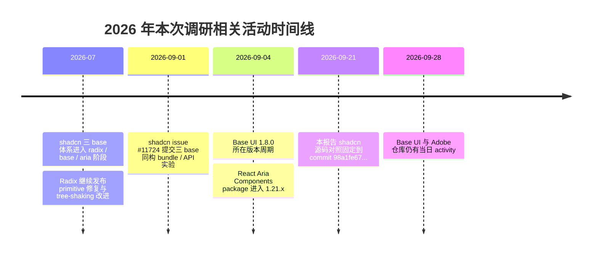
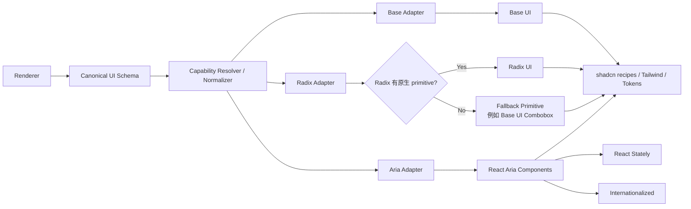

# Base UI、Radix UI、React Aria 与 shadcn/ui 三 Base 源码级深度调研报告

## Executive Summary

截至 **2026 年 9 月 28 日**，Base UI、Radix UI 与 React Aria 已经不能再简单理解为三个“同层级、可直接互换”的 Headless UI 库。**Radix UI 的核心仍是低层 UI primitives；Base UI 是围绕 compound components、`render`、状态属性与 Floating UI 构建的新一代 headless component system；React Aria 则进一步覆盖了行为、collection、selection、state、i18n、Date/Time、Virtualization、Drag & Drop 等应用基础设施。**官方组件目录和 package 架构清楚体现了这一点。citeturn19view0turn19view4turn23view1

shadcn/ui 当前确实把 `radix`、`base`、`aria` 都定义成正式 preset base；但源码调查得到一个非常关键的结论：**shadcn 的 “base” 是生成代码的目标/预设，而不是底层库纯度边界。**最典型的例子是 `radix/ui/combobox.tsx`：它并没有使用 Radix Combobox，而是直接导入 `@base-ui/react` 的 Combobox，因为 Radix core 当前没有对应的正式 Combobox primitive。fileciteturn41file0L1-L6 fileciteturn34file0L1-L6

因此，对你要构建的 **AI + 0-Code UI Runtime**，最重要的架构结论不是“选 Base / Radix / Aria 中的一个”，而是：**Canonical Schema 必须独立于 shadcn 和三套底层 API，并通过 capability-aware Adapter 做有损/无损映射。**尤其不能把 `value/onValueChange`、`selectedKey/onSelectionChange`、`checked/onCheckedChange`、`isSelected/onChange` 等底层 API 原样暴露给 Schema。

从默认技术选择看，我会把 **Base UI 作为通用 primitive 默认 Adapter，React Aria 作为 Collection/Data/Date/DnD/I18n 高级 Adapter，Radix 作为成熟兼容 Adapter**。这不是品牌偏好，而是来自组件覆盖、shadcn 源码、依赖模型和同构 bundle 实验的综合判断。Base UI 1.8.0 与 Radix umbrella 1.6.7 都标记 `sideEffects: false`；React Aria Components 1.21.1 则带来 `react-aria`、`react-stately`、Internationalized 等更厚的能力栈，因此在同一 shadcn 可复现实验中 gzip JS 也明显更大。fileciteturn30file0L1-L5 fileciteturn31file0L1-L6 fileciteturn32file0L1-L6

> **最终判断：不要设计 `RadixSelect.Root` / `BaseUI.Select.Root` / `ReactAria.Select` Schema；设计 `Select / Collection / Overlay / Field / Selection / Action` 等语义协议。**

## 互联网 / 官网收集

### 三者真正处在不同的抽象层

Radix 官方明确把 Primitives 定义为 **low-level UI component library**，强调 accessibility、customization、developer experience；它负责 ARIA 属性、role、focus management、keyboard navigation，采用 granular component parts，并允许 controlled / uncontrolled 两种使用方式。citeturn19view4

Base UI 官方当前提供一个单一、tree-shakable 的 `@base-ui/react` 包，组件包括 Dialog、Drawer、Autocomplete、Combobox、Field、Form、Input、Number Field、OTP Field、Select、Tabs 等；官方同时把 `Direction Provider`、`mergeProps`、`useRender` 等列入公共工具层。Base UI 明确无样式、不携带 CSS，并支持 Tailwind、CSS Modules、CSS-in-JS。citeturn19view0turn19view2

React Aria Components 则明显超出了普通 primitive 库的边界。当前官方目录包括 **Autocomplete、Calendar、ComboBox、DateField、DatePicker、DateRangePicker、DropZone、FileTrigger、GridList、ListBox、NavigationTree、NumberField、RangeCalendar、Table、Tree、Virtualizer** 等；Adobe monorepo 又把 React Aria、React Stately 和 Internationalized packages 分层维护。Adobe 官方说明其体系提供 WAI-ARIA 行为、屏幕阅读器和键盘支持、鼠标/触控适配，以及 30 多种语言、RTL、日期和数字格式化。citeturn23view1turn26view1

因此更准确的概念模型是：

| 维度 | Base UI | Radix UI | React Aria |
|---|---|---|---|
| 首要抽象 | Headless Components | UI Primitives | Components + Behaviors + State + Collections |
| 典型职责 | UI 行为 + composition + positioning | 基础交互 primitive | 可访问性 + collection + state + i18n + 高级交互 |
| 组合方式 | `render` / `useRender` | `asChild` / `Slot` | component composition / slots / contexts / render props |
| 控制状态风格 | `value/onValueChange` 等 | `value/onValueChange` 等 | 按组件而异；Tabs 等 key-based，现代 Select 已提供 value-oriented API |
| 状态样式 | `[data-checked]`、`[data-open]` 等 | 经典 `data-state` 等 | `[data-selected]`、`[data-pressed]`、`[data-hovered]` 等 |
| 高级 Collection | 有限 / 逐步增加 | 不作为核心平台 | **核心优势** |
| Date/Calendar | 无公开完整 DatePicker 系列 | 无 | **完整** |
| Table/GridList/Tree | 无统一 collection 平台 | 无统一平台 | **完整** |
| Virtualization / DnD | 无统一层 | 无统一层 | **完整体系** |
| 国际化深度 | Direction 等基础设施 | Direction / RTL 基础能力 | **Internationalized 子系统** |

上述覆盖来自三个项目当前官方组件目录及 Adobe 的架构说明。citeturn19view0turn19view4turn23view1turn26view1

### 重点组件覆盖矩阵

下表的“原生”指相应核心库提供正式 primitive/component，而不是可以通过 Dialog 等自行拼出来。Radix 当前官方目录中并没有正式 Combobox、Autocomplete、Drawer、Calendar、DatePicker、Table、GridList、Virtualizer、NumberField；它已有 Form Preview 和 One-Time Password Field Preview。citeturn19view4 Base UI 当前公开 exports 则明确包含 Autocomplete、Combobox、Drawer、Field、Form、Number Field、OTP Field。citeturn19view0 React Aria 当前组件目录明确覆盖 Calendar、DatePicker、DateRangePicker、GridList、Table、Tree、Virtualizer、DropZone、FileTrigger 等。citeturn23view1

| 能力 | Base UI | Radix UI | React Aria |
|---|---:|---:|---:|
| Dialog / Alert Dialog | ✅ 原生 | ✅ 原生 | ✅ Dialog + Modal |
| Select | ✅ | ✅ | ✅ |
| Combobox | ✅ | ❌ core 无正式对应 | ✅ |
| Autocomplete | ✅ | ❌ | ✅ |
| Input / Field | ✅ | 部分 primitive / Form 体系 | ✅ TextField/Input |
| Checkbox | ✅ | ✅ | ✅ |
| Radio Group | ✅ | ✅ | ✅ |
| Form | ✅ | ⚠️ Form Preview | ✅ |
| Tabs | ✅ | ✅ | ✅ |
| Menu | ✅ | ✅ | ✅ |
| Popover | ✅ | ✅ | ✅ |
| Tooltip | ✅ | ✅ | ✅ |
| Drawer | ✅ | ❌ dedicated primitive | ⚠️ Modal 可组合 |
| OTP | ✅ OTP Field | ✅ Preview / package | ⚠️ 无 dedicated OTP |
| NumberField | ✅ | ❌ dedicated primitive | ✅ |
| Calendar | ❌ public component | ❌ | ✅ |
| DatePicker | ❌ public component | ❌ | ✅ |
| DateRangePicker | ❌ | ❌ | ✅ |
| Table collection | ❌ | ❌ | ✅ |
| GridList | ❌ | ❌ | ✅ |
| Tree | ❌ | ❌ | ✅ |
| Virtualizer | ❌ | ❌ | ✅ |
| DropZone/FileTrigger | ❌ | ❌ | ✅ |
| Collection DnD | ❌ unified layer | ❌ unified layer | ✅ |

这张表也解释了为什么“React Aria 就是 Adobe 版 Radix”是一个错误抽象：React Aria 的问题域明显更大。citeturn23view1turn26view1

### Render、slots 与 DOM composition

Base UI 的核心差异之一是 `render`。官方要求自定义组件 forward ref 并 spread props，支持把 React element 传给 `render`，也允许使用 `render={(props, state) => ...}` 获得组件状态。它不仅是替换 DOM tag，而是在 composition 层完成 props、ref、behavior 的合并。citeturn19view1

典型语义是：

```tsx
<Menu.Trigger render={<MyButton />}>
  Open
</Menu.Trigger>
```

而 Radix 的经典模型是：

```tsx
<Dialog.Trigger asChild>
  <MyButton />
</Dialog.Trigger>
```

Radix 官方把 UI 分解为可单独包装的 granular parts；其 composition philosophy 是通过 Slot/`asChild` 让一个 child 承接 primitive 的行为。citeturn19view4

React Aria 则更接近：

```tsx
<Select>
  <Label />
  <Button>
    <SelectValue />
  </Button>
  <Popover>
    <ListBox />
  </Popover>
</Select>
```

官方说明每一个 React Aria component 通常对应一个 DOM element，复杂 pattern 由多个组件拼合；同时 state 可以通过 data attributes 和 render props 暴露。citeturn23view0

对于你的 Schema Runtime，这意味着三套模型最好抽象成：

```text
Base       = Parts + render(element | fn)
Radix      = Parts + asChild/Slot
React Aria = Parts + Context/Slot + Collection + RenderProps
```

而不是尝试把三套 React JSX 树逐节点一一对应。

### Styling、data attributes 与 CSS Variables

Base UI 官方明确承诺没有 bundled CSS；其 `className` 和 `style` 都可以根据 state 计算，并公开诸如 `[data-checked]`、`[data-unchecked]` 等状态属性；Popup 一类 primitive 还会提供 `--available-height`、`--anchor-width` 等动态 CSS variables。citeturn19view2

Radix 同样 unstyled，官方定位就是可使用任何 styling solution 的低层 primitives。其长期稳定的设计模式是由 primitive DOM 输出交互状态，再由用户 CSS/Tailwind 根据状态处理视觉。citeturn19view4turn27search5

React Aria 官方当前示例直接展示 `[data-selected]`，并说明组件公开 pressed、hovered、selected 等 state data attributes，同时也可以用 render props 获取状态。citeturn23view0

因此 Canonical Theme 层不应该直接把：

```css
[data-state="open"]
```

当成标准协议；应该设计：

```text
Canonical state = open
             ↓
Base  -> data-open
Radix -> data-state="open" / primitive-specific state
Aria  -> data-open / isOpen / primitive-specific attribute
```

具体 CSS attribute 应由 Adapter 或样式 compiler 决定。

### Accessibility、i18n、SSR / RSC

Radix 官方明确遵循 WAI-ARIA design patterns，并负责 ARIA/role、焦点和键盘导航。citeturn19view4

React Aria 在这一层做得最系统。Adobe 说明 React Aria/Spectrum 会进行 screen reader、keyboard 和多设备测试，并在其 Internationalized 层提供 30+ 语言、RTL、date/number formatting。citeturn26view1 这也是 DatePicker、Calendar、NumberField 这类组件中它的架构优势：locale 不是最后附加的一层格式化，而是基础系统的一部分。

SSR/RSC 则需要特别区分“**可以服务器生成 HTML**”和“**交互组件是不是 Server Component**”。三套库都属于 React 交互基础设施；在当前 shadcn 生成代码里，Dialog、Combobox、Tabs、Checkbox 等文件都明确包含 `"use client"`，所以在 Next.js RSC 架构中应把它们理解为 **client boundary 内的 UI runtime**，而不是直接把 Headless primitive 当作纯 Server Component。这个事实可以直接从三套 shadcn Dialog/Combobox 源码确认。fileciteturn42file0L1-L5 fileciteturn43file0L1-L5 fileciteturn44file0L1-L5 fileciteturn35file0L1-L5

React Aria 官方表示它可工作于 React frameworks，并提供 framework setup 来优化 bundle 和 internationalization；其当前 `react-aria-components` package 又直接依赖 `client-only`、`react-aria`、`react-stately`。因此，对于你的架构，**把 Schema/Data fetching 留在 server，把交互 renderer adapter 放 client boundary** 会比追求“整个 Headless UI RSC 化”更稳健。citeturn23view0 fileciteturn32file0L1-L6

### LLM / AI 友好度

这一维现在已经不是边缘问题。

Base UI 每个文档页明确提供 **View as Markdown**，还提供 `llms.txt`，官方 Quick Start 单独设有 “Working with LLMs”。citeturn19view0

React Aria 做得更进一步：当前官方文档提供把页面复制/打开到 AI assistant、MCP Server、Agent Skills、`llms.txt`，并在页面底部提供 “Copy for LLM”。citeturn23view0turn23view2

从 **AI agent 自动检索 UI API** 的角度，我会这样评级：

| AI 文档能力 | Base UI | Radix UI | React Aria |
|---|---|---|---|
| Markdown-friendly docs | ✅ 明确支持 | 普通 Web 文档 | ✅ |
| `llms.txt` | ✅ | 未见同等官方重点入口 | ✅ |
| MCP docs integration | 未见同等级官方入口 | 未见 | ✅ |
| Agent Skills | 未见 | 未见 | ✅ |
| Examples 可机器复制 | ✅ | ✅ | ✅ |
| API 复杂度 | 低～中 | 低～中 | 中～高 |
| AI agent 上下文成本 | 较低 | 较低 | 较高，但机器文档最好 |

这使 React Aria 出现一个有趣现象：**API/体系最复杂，但 AI 工具链反而最完整。**citeturn23view2

## GitHub 仓库对比（含表格）

### GitHub 活跃度与 package 结构

以下指标均按 **2026-09-28 调研时点**。GitHub REST 的 `open_issues_count` 实际包含 open issues 与 open PR，因此这里统一称“开放项”；commit 数取 GitHub 仓库页面展示值，且三个 monorepo 的范围不同，不宜用作纯粹质量排名。Base UI 当前约 11.0k stars / 558 forks，Radix 约 19.3k / 1.25k，Adobe React Spectrum 约 15.9k / 1.58k。fileciteturn36file0L1-L6 fileciteturn28file0L1-L6 fileciteturn29file0L1-L6

| 项目 | Stars | Forks | 开放项¹ | Repo commits² | 最近 repo push | 核心 package | License |
|---|---:|---:|---:|---:|---|---|---|
| Base UI | 11,007 | 558 | 442 | 4,898 | 2026-09-28 | `@base-ui/react 1.8.0` | MIT |
| Radix Primitives | 19,340 | 1,250 | 356 | 1,878 | 2026-08-08 | `radix-ui 1.6.7` | MIT |
| React Spectrum / Aria | 15,894 | 1,581 | 589 | 6,774 | 2026-09-28 | `react-aria-components 1.21.1` | Apache-2.0 |
| shadcn/ui | 124,729 | 11,613 | 1,841 | — | 2026-09-24 | source registry / CLI | MIT |

¹ GitHub REST repo field；² GitHub repository UI 快照，monorepo 范围不同。Base 的 GitHub 页面显示 4,898 commits；Radix 页面显示 1,878；Adobe 页面显示 6,774。citeturn25search12turn27search2turn26view1 shadcn 与三个底层项目的 REST 指标来自各自官方仓库。fileciteturn40file0L1-L6

GitHub 活跃度本身也揭示不同阶段：Base UI 在 2026-09-28 仍有当日 push；Adobe React Spectrum 也是当日 push；Radix 当前仓库 push 时间较早，但 2026 年 7 月官方 releases 仍在持续更新 Dialog、tree-shaking 等内容，因此不能把“Radix 更新频率较低”理解成项目停滞。fileciteturn36file0L1-L6 fileciteturn29file0L1-L6 citeturn27search8



版本来自各项目当前 `package.json`。fileciteturn30file0L1-L5 fileciteturn31file0L1-L5 fileciteturn32file0L1-L5

### 依赖树与 tree-shaking

Base UI 当前 package：

```text
@base-ui/react 1.8.0
├─ @base-ui/utils
├─ @floating-ui/react-dom
├─ @floating-ui/utils
├─ @babel/runtime
└─ use-sync-external-store
```

并明确 `"sideEffects": false`。其 public exports 包含每个组件的 subpath，例如 `./combobox`、`./drawer`、`./number-field`、`./otp-field` 和 `./use-render`。fileciteturn30file0L1-L5

Radix 的 umbrella package 是另一种结构：

```text
radix-ui 1.6.7
├─ @radix-ui/react-dialog
├─ @radix-ui/react-select
├─ @radix-ui/react-tabs
├─ @radix-ui/react-slot
├─ @radix-ui/react-popper
├─ @radix-ui/react-focus-scope
├─ ...
└─ dozens of @radix-ui/react-* packages
```

但同样声明 `"sideEffects": false`，而且统一 package 的 exports 支持 subpath。fileciteturn31file0L1-L6

React Aria Components 则：

```text
react-aria-components 1.21.1
├─ react-aria 3.52.1
├─ react-stately 3.50.0
├─ @internationalized/date
├─ @internationalized/string
├─ @react-types/shared
├─ @swc/helpers
└─ client-only
```

其 `sideEffects` 不是完全 false，而是声明 `["*.css"]`。这并不等价于“无法 tree-shake”；它表示 CSS 文件被视作 side effect，而 JS exports 仍以模块化构建输出。fileciteturn32file0L1-L6

### bundle / gzip：最有价值的是同构实验，而不是 npm 包裸大小

shadcn 官方仓库 issue #11724 提供了一个很值得参考的 **用户提交可复现实验**：同一个 Vite app、同样 12 个 shadcn components、不同 base 构建。它不是 shadcn 官方 benchmark，因此不能视为绝对性能结论，但因为应用、组件集合和 bundler 都被控制住，比直接比较 npm tarball size 更有意义。fileciteturn17file0L1-L3

| base | JS raw | JS gzip | CSS gzip | 总 gzip | Brotli |
|---|---:|---:|---:|---:|---:|
| Radix | 304.4 KB | **95.0 KB** | 8.7 KB | **103.6 KB** | 89.8 KB |
| Base UI | 328.7 KB | **104.8 KB** | 8.7 KB | **113.3 KB** | 97.6 KB |
| React Aria | 483.0 KB | **145.6 KB** | 9.0 KB | **153.9 KB** | 129.9 KB |

在这个特定样本中，Base UI 相比 Radix 多约 **9.8 KB JS gzip**；React Aria 相比 Radix多约 **50.6 KB JS gzip**。这个结果和依赖结构方向上是一致的：React Aria 在 runtime 中承载了更多 state / collection / i18n infrastructure。这里必须强调：**这不是“React Aria 永远大 50 KB”，只是该可复现组件集的结果。**fileciteturn17file0L1-L3

### shadcn 三 base 的真实 registry 架构

shadcn 当前 preset 源码在：

```text
packages/shadcn/src/preset/preset.ts
```

其中：

```ts
export const PRESET_BASES = ["radix", "base", "aria"] as const
```

这说明 `radix/base/aria` 已经是 preset encoding 的正式一部分。本文源码比较固定在可复现 commit：

```text
98a1fe67b439324ddc857f47fbdce056600a4329
```

对应文件 URL 也全部固定到这个 hash。fileciteturn41file0L1-L6

整体关系更准确地表示为：



**最关键发现是 Radix branch 中出现 fallback。**当前 shadcn 的：

```text
apps/v4/registry/bases/radix/ui/combobox.tsx
```

开头实际上导入的是：

```ts
import { Combobox as ComboboxPrimitive } from "@base-ui/react"
```

而不是 `radix-ui`。fileciteturn34file0L1-L6

这一个文件基本足以否定：

> `shadcn base = underlying library 1:1 abstraction`

更准确的是：

> `shadcn base = registry preset + composition conventions + preferred primitive provider`

这对你的 Adapter 设计至关重要。

## 逐组件源码差异（含表格 / 代码片段）

本节固定对照 `shadcn-ui/ui@98a1fe67b439324ddc857f47fbdce056600a4329`，避免“今天代码变了，明天无法复现”的问题。fileciteturn41file0L1-L6

### Dialog：三种 composition philosophy 最清楚的样本

对应文件：

```text
apps/v4/registry/bases/base/ui/dialog.tsx
apps/v4/registry/bases/radix/ui/dialog.tsx
apps/v4/registry/bases/aria/ui/dialog.tsx
```

Base 实现导入 `@base-ui/react/dialog`，并将 shadcn `DialogOverlay` 映射到 Base `Backdrop`，`DialogContent` 映射到 Base `Popup`；关闭按钮使用 Base 的 `render` composition。fileciteturn42file0L1-L6

核心形态：

```tsx
<DialogPrimitive.Close render={<Button />}>
```

Radix 则对应传统结构 `Root → Portal → Overlay → Content`，关闭按钮使用 `asChild`。fileciteturn43file0L1-L6

```tsx
<DialogPrimitive.Close asChild>
  <Button />
</DialogPrimitive.Close>
```

Aria 差别最大：源码使用 `DialogTrigger + ModalOverlay + Modal + Dialog` 组合；关闭动作不是 `Close primitive` wrapper，而是 button 的 `slot="close"`。fileciteturn44file0L1-L6

```tsx
<Button slot="close" />
```

所以 Dialog 的实际映射不是：

```text
DialogContent ↔ DialogContent ↔ DialogContent
```

而是：

| Canonical concept | Base | Radix | React Aria |
|---|---|---|---|
| root/state | `Dialog.Root` | `Dialog.Root` | Trigger/Modal ownership |
| trigger | `Dialog.Trigger` | `Dialog.Trigger` | `DialogTrigger` |
| portal | explicit `Portal` | explicit `Portal` | overlay/modal abstraction |
| overlay | `Backdrop` | `Overlay` | `ModalOverlay` |
| content | `Popup` | `Content` | `Modal` + `Dialog` |
| close | `Close render=` | `Close asChild` | `Button slot="close"` |
| dismiss prop | primitive-specific | primitive-specific | `isDismissable` |

这是为什么 Canonical Schema 应该定义 **overlay semantics**，而不是定义 React component tree。

### Select：表面相似，popup 和 collection 模型完全不同

Base shadcn Select 基于 Base UI Root / Trigger / Portal / Positioner / Popup / List / Item 等 parts；positioning API 直接暴露 `side`、`align`、`sideOffset`、`alignOffset`、`anchor` 一类概念，并使用 `--available-height`、`--anchor-width`、`--transform-origin` 等 Base CSS variables。fileciteturn13file0L1-L6 Base 官方 styling 文档也说明这类 generic CSS variables 是其正式 style hooks。citeturn19view2

Radix Select 则走：

```text
Root
  Trigger
  Portal
    Content
      Viewport
        Item
```

并使用类似 `--radix-select-trigger-width`、`--radix-select-content-available-height` 这样的 Radix-specific CSS vars。fileciteturn14file0L1-L6

React Aria 的 shadcn Select 则组合 `Select + Button + SelectValue + Popover + ListBox + ListBoxItem`，item selection 通过 render state `isSelected` 生成 check indicator；源码还引入 SearchField，让同一个 shadcn abstraction 可以组合 searchable select。fileciteturn15file0L1-L6 React Aria 官方也把 Select 展示为 `Label → Button/SelectValue → Popover/ListBox` 的组成模式。citeturn23view0

值得纠正一个非常常见的误解：**不能简单说“React Aria 所有 selection 都是 selectedKey/onSelectionChange”。**Tabs 和底层 SingleSelect state 确实仍然是 key-oriented API；但当前 React Aria Select 已向 value-oriented API 演进。因此 Adapter 应该逐组件处理，而不是建立一个“Aria = selectedKey”的全局规则。React Aria 的 Tabs state 官方仍明确有 `selectedKey/defaultSelectedKey/onSelectionChange`。citeturn24search0

### Combobox：本次源码调查最重要的发现

Base 文件：

```text
apps/v4/registry/bases/base/ui/combobox.tsx
```

完整使用 `@base-ui/react` Combobox，公开 Value、Trigger、Clear、Input、Popup、List、Item、Collection、Chips、Chip 等，并大量使用 Base `render` composition。fileciteturn33file0L1-L6

Radix 文件：

```text
apps/v4/registry/bases/radix/ui/combobox.tsx
```

**同样使用 `@base-ui/react` Combobox。**两者主体非常接近；差别之一反而来自 shadcn 自己的 radix Button/InputGroup wrapper 在组合时继续使用 `asChild`。fileciteturn34file0L1-L6

这意味着当前真实依赖关系是：

```text
shadcn(base)/Combobox  → Base UI Combobox

shadcn(radix)/Combobox → Base UI Combobox
                          ↑
                    Radix preset 并非纯 Radix

shadcn(aria)/Combobox  → React Aria ComboBox
                         + ListBox
                         + Collection
                         + TagGroup
                         + ComboBoxStateContext
```

Aria 版本明显复杂得多。它使用 `ComboBoxStateContext` 实现 clear、使用 `onPress` 而不是 DOM-centric click contract，List item 用 `composeRenderProps(..., {isSelected})`，chips 使用 TagGroup/TagList，并且 positioning 对应 `placement/offset/crossOffset/triggerRef`，而不是 Base 的 `side/align/...`。fileciteturn35file0L1-L6

可以编程描述为：

| 能力 | Base shadcn | Radix shadcn | Aria shadcn |
|---|---|---|---|
| primitive provider | Base UI | **Base UI** | RAC |
| clear | `Combobox.Clear` | `Combobox.Clear` | context `setValue(null)` |
| trigger compose | `render` | Base primitive + shadcn `asChild` | Aria Button |
| list | Base `List` | Base `List` | `ListBox` |
| item state | Base item state attrs | Base item state attrs | `isSelected` render state |
| dynamic collection | Base Collection | Base Collection | RAC `Collection` |
| multi chips | Base Chips/Chip | Base Chips/Chip | TagGroup/TagList/Tag |
| positioning | side/align | side/align | placement/offset/crossOffset |

这也是我认为 **Combobox 应该成为 Adapter POC 的第一个复杂组件** 的原因：它一次性覆盖 value、query、selection、collection、overlay、clear、multi-value/chips 和 keyboard/a11y。

### Tabs：这里会暴露真正的 state-model 差异

Base 的 shadcn wrapper基本是：

```text
Root → List → Tab → Panel
```

并沿用 value-oriented component architecture。fileciteturn18file0L1-L6

Radix 也是：

```text
Root → List → Trigger → Content
```

对调用层来说仍然非常接近 `value/defaultValue/onValueChange` 模型。fileciteturn19file0L1-L6

React Aria 则是：

```text
Tabs → TabList → Tab → TabPanel
```

且 selection 是 collection key-oriented：官方底层 `useTabListState` 当前仍公开 `selectedKey`、`defaultSelectedKey`、`onSelectionChange` 和 `disabledKeys`。citeturn24search0 shadcn Aria wrapper也直接围绕 RAC Tabs/TabList/Tab/TabPanel 构建。fileciteturn20file0L1-L6

因此：

```text
Canonical.selectedId = "settings"

Base  -> value="settings"
         onValueChange(id)

Radix -> value="settings"
         onValueChange(id)

Aria  -> selectedKey="settings"
         onSelectionChange(key)
```

这才是 Adapter 真正应该处理的内容。

### Checkbox：boolean state 也并不一致

Base 和 Radix 的 shadcn Checkbox 都采用 Root + Indicator 的 primitive 模式，两者结构高度相似。fileciteturn21file0L1-L6 fileciteturn22file0L1-L6

Aria 版本没有独立 Indicator primitive；shadcn 使用单个 `CheckboxPrimitive`，然后通过 `composeRenderProps` 获取：

```text
isSelected
isIndeterminate
```

再决定是否绘制 indicator。fileciteturn23file0L1-L6

所以 Schema 中不应该写：

```json
{
  "checked": true,
  "onCheckedChange": "..."
}
```

而应该写 semantic state：

```json
{
  "value": true,
  "indeterminate": false
}
```

由 Adapter 转成：

| Canonical | Base | Radix | React Aria |
|---|---|---|---|
| `value: boolean` | `checked` | `checked` | `isSelected` |
| `defaultValue` | `defaultChecked` | `defaultChecked` | `defaultSelected` |
| `onValueChange` | `onCheckedChange` | `onCheckedChange` | `onChange` |
| `disabled` | `disabled` | `disabled` | `isDisabled` |
| indeterminate | primitive state | primitive state | `isIndeterminate` |

### Form / Field：shadcn 当前并没有你可能预期的“三套 Form primitive adapter”

这里需要特别纠正。

在当前三 base registry 中，新的 `field.tsx` **主要是 shadcn 自己的 layout/validation presentation abstraction**，而不是简单地：

```text
Base Field   -> @base-ui/react/field
Radix Field  -> radix-ui Form
Aria Field   -> RAC Form
```

例如 Radix `field.tsx` 本身用的是 native `<fieldset>`、`<legend>`、`<div role="group">`，只从该 base 的 shadcn Label 和 Separator 引入基础零件。fileciteturn38file0L1-L6 Aria 版本同样主要是 shadcn-owned HTML/layout wrapper，只有 Label/Separator 来自 aria registry。fileciteturn26file0L1-L6

Base 版本也是相同设计方向，而不是直接把 Base UI `Field.Root` 作为整个 shadcn Field。fileciteturn25file0L1-L6

另外，直接寻找：

```text
apps/v4/registry/bases/base/ui/form.tsx
```

并不存在对应的三套平行文件；旧 registry 中仍可看到基于 `react-hook-form` 的 `new-york-v4/ui/form.tsx`。fileciteturn27file0L1-L12

这意味着对你的平台而言，**Form Engine 绝对不应该绑定任何一个 headless library**。正确分层应该是：

```text
Schema Validation / Form State
             ↓
Canonical Field Contract
             ↓
Form Control Adapter
             ↓
Input / Select / Checkbox / DatePicker ...
```

而不是：

```text
Schema
 ↓
Radix Form / Base Form / React Aria Form
```

### 逐文件差异总表

| shadcn 文件 | Base | Radix | Aria | 最重要的 Adapter 问题 |
|---|---|---|---|---|
| `dialog.tsx` | Backdrop/Popup + `render` | Overlay/Content + `asChild` | ModalOverlay/Modal/Dialog + `slot=close` | Overlay anatomy |
| `select.tsx` | Positioner/Popup/List | Content/Viewport | Popover/ListBox | collection + positioning |
| `combobox.tsx` | Base UI native | **Base UI fallback** | RAC ComboBox + Collection | provider 不纯 + collection |
| `tabs.tsx` | value | value | selectedKey | selection state |
| `checkbox.tsx` | Root/Indicator | Root/Indicator | single component + render state | boolean state |
| `field.tsx` | shadcn-owned | shadcn-owned | shadcn-owned | Form 不等于 primitive base |

对应源文件均来自固定 commit 的官方 shadcn 仓库。fileciteturn42file0L1-L6 fileciteturn43file0L1-L6 fileciteturn44file0L1-L6 fileciteturn33file0L1-L6 fileciteturn34file0L1-L6 fileciteturn35file0L1-L6

## Adapter 映射表

从上面的源码可以得出一个比较明确的设计原则：

> **Canonical 层只描述语义；Adapter 层负责 prop renaming、event normalization、DOM composition、state attrs、overlay positioning、collection semantics 与 capability fallback。**

### 核心可编程映射

| Canonical Contract | Base Adapter | Radix Adapter | Aria Adapter | 风险 |
|---|---|---|---|---|
| `open` | `open` | `open` | `isOpen` / context-dependent | 中 |
| `onOpenChange(v)` | `onOpenChange` | `onOpenChange` | `onOpenChange` | 低 |
| `value` Select | `value` | `value` | 当前 Select `value` | 低～中 |
| `onValueChange(v)` Select | `onValueChange` | `onValueChange` | `onChange` | 中 |
| `selectedId` Tabs | `value` | `value` | `selectedKey` | **高** |
| `onSelectedIdChange` | `onValueChange` | `onValueChange` | `onSelectionChange` | **高** |
| `checked` semantic | `checked` | `checked` | `isSelected` | 中 |
| `onCheckedChange` semantic | `onCheckedChange` | `onCheckedChange` | `onChange` | 中 |
| `disabled` | `disabled` | `disabled` | `isDisabled` | 低 |
| `required` | `required` | `required` | `isRequired` | 低 |
| trigger composition | `render` | `asChild` | actual component / slot / context | **高** |
| custom rendered element | `render` | `asChild` | render props / Link render / component composition | 高 |
| popup `side` | `side` | `side` | `placement` 转换 | 中 |
| popup `sideOffset` | `sideOffset` | `sideOffset` | `offset` | 中 |
| popup `alignOffset` | `alignOffset` | `alignOffset` | `crossOffset` | 中 |
| popup custom anchor | `anchor` | anchor/trigger model | `triggerRef` | 高 |
| `items` | Collection / items where supported | mostly primitive-specific | Collection / items | 高 |
| multiple selection | component-specific | component-specific | `selectionMode` / collection state | 高 |
| item selected state | data/component state | data-state | `isSelected` / data-selected | 中 |
| close action | Close part | Close part | close slot/context | 高 |
| form error | Field/Form state | Form / external state | validation state | 高 |

Base composition 的 `render` 是官方设计，React Aria 的 component/data attribute/render-prop composition 也是官方设计；Radix 的 primitive architecture 则强调 granular parts。citeturn19view1turn19view4turn23view0

### Capability 不应只有 boolean

建议 Adapter registry 不写：

```ts
supportsCombobox: true
```

而是：

```ts
type CapabilityLevel =
  | "native"
  | "adapted"
  | "fallback"
  | "emulated"
  | "unsupported"
```

于是当前可以表达：

| Capability | Base | Radix preset | Aria |
|---|---|---|---|
| `combobox.single` | native | **fallback:base-ui** | native |
| `combobox.multipleChips` | native | **fallback:base-ui** | adapted/native collection |
| `calendar` | unsupported | unsupported | native |
| `datePicker` | unsupported | unsupported | native |
| `table.collection` | unsupported | unsupported | native |
| `virtualization` | unsupported | unsupported | native |
| `collectionDnD` | unsupported | unsupported | native |
| `drawer` | native | emulated/composed | emulated via modal |
| `otp` | native | native/preview | emulated |
| `numberField` | native | unsupported/emulated | native |

其中 `radix/combobox = fallback:base-ui` 是当前 shadcn 官方源码可以直接验证的事实。fileciteturn34file0L1-L6 高级 React Aria 组件范围由官方目录直接确认。citeturn23view1

### 推荐 Adapter interface

```ts
type AdapterCapability =
  | "native"
  | "adapted"
  | "fallback"
  | "emulated"
  | "unsupported"

interface ComponentAdapter<TCanonical, TNative> {
  readonly id: string

  capability(
    feature: string
  ): {
    level: AdapterCapability
    provider?: string
    reason?: string
  }

  normalizeProps(
    input: TCanonical
  ): TNative

  normalizeEvent(
    event: unknown
  ): CanonicalUIEvent

  normalizeState(
    nativeState: unknown
  ): CanonicalState

  render(
    node: CanonicalNode,
    context: RenderContext
  ): React.ReactNode
}
```

建议这里**把 provider 和 adapter 分开**。例如：

```text
adapter.id       = "radix"
component        = "Combobox"
provider         = "@base-ui/react"
capability.level = "fallback"
```

这样以后 UI Inspector、AI generator、telemetry 都能准确知道最终使用了哪个 runtime，而不会因为“preset 名叫 radix”就产生错误假设。这个设计直接回应了 shadcn 当前 Combobox 的跨-provider实现。fileciteturn34file0L1-L6

## 建议的 Canonical Schema 草案

### 不要复制 React props，要定义语义

我建议顶层至少拆成以下概念：

```text
Component
State
Selection
Collection
Overlay
Field
Validation
Interaction
Slots
Style
Capability Requirements
Events / Actions
```

而不是让每个组件自己重新定义 `onChange`、`onValueChange`、`onSelectionChange`。

例如整个 Runtime：

```text
                  Application Schema
                         │
                         ▼
                 Canonical UI AST
                         │
          ┌──────────────┼──────────────┐
          │              │              │
      State Engine   Action Engine  Data/Collection
          │              │              │
          └──────────────┼──────────────┘
                         ▼
                 Capability Resolver
                         │
           ┌─────────────┼─────────────┐
           ▼             ▼             ▼
      Base Adapter   Radix Adapter   Aria Adapter
           │             │             │
           ▼             ▼             ▼
       Base UI       Radix/Fallback    RAC
                                         │
                               ┌─────────┴─────────┐
                               ▼                   ▼
                         React Stately      Internationalized
```

React Aria 本身已经展示出 Component / Collection / State 分层的价值；Adobe monorepo明确把 React Aria、React Stately 和 Internationalized 分成不同职责。citeturn26view1

### Combobox Schema 示例

这是我认为最适合先实现的 Canonical POC：

```json
{
  "$schema": "https://headless.example/schemas/ui/v0.1.json",
  "schemaVersion": "0.1",

  "id": "country",
  "type": "Combobox",

  "state": {
    "value": {
      "$bind": "form.country"
    },
    "open": {
      "$bind": "ui.country.open"
    }
  },

  "selection": {
    "mode": "single",
    "allowEmpty": true
  },

  "collection": {
    "source": {
      "$ref": "data.countries"
    },
    "key": "code",
    "textValue": "name",
    "filter": {
      "mode": "contains",
      "localeAware": true
    }
  },

  "field": {
    "name": "country",
    "label": "国家 / 地区",
    "required": true,
    "disabled": false,
    "readOnly": false
  },

  "overlay": {
    "placement": "bottom-start",
    "offset": 6,
    "crossOffset": 0,
    "matchTriggerWidth": true,
    "collision": "flip-shift"
  },

  "slots": {
    "input": {
      "placeholder": "搜索国家"
    },
    "trigger": {
      "type": "IconButton",
      "icon": "chevron-down"
    },
    "clear": {
      "enabled": true
    },
    "item": {
      "type": "Text",
      "value": "{{item.name}}"
    },
    "empty": {
      "type": "Text",
      "value": "没有匹配结果"
    }
  },

  "events": {
    "valueChange": {
      "action": "form.setValue",
      "args": {
        "path": "country",
        "value": "$event.value"
      }
    }
  },

  "requires": {
    "combobox": true,
    "filtering": true,
    "selection": "single",
    "collection": true
  }
}
```

关键是 Schema 中没有：

```text
onValueChange
onSelectionChange
selectedKey
isDisabled
render
asChild
slot="remove"
```

这些都是 **Renderer implementation details**。

### Adapter 编译结果示意

对 Base UI，可编译为：

```tsx
<Combobox.Root
  value={value}
  onValueChange={handleValueChange}
>
  {/* Base Positioner / Popup / Collection */}
</Combobox.Root>
```

Base 当前确实提供 native Combobox/Collection/chips 等能力。fileciteturn33file0L1-L6

Radix preset：

```ts
resolve("Combobox")
// =>
{
  adapter: "radix",
  provider: "@base-ui/react",
  capability: "fallback"
}
```

这是当前 shadcn 源码的真实情况。fileciteturn34file0L1-L6

Aria：

```tsx
<ComboBox
  value={value}
  onChange={handleValueChange}
>
  <Input />
  <Button />
  <Popover>
    <ListBox items={items}>
      {/* items */}
    </ListBox>
  </Popover>
</ComboBox>
```

如果是多选/Chip 模式，还可能通过 `ComboBoxValue`、TagGroup/TagList 和 collection state 完成；shadcn Aria 当前实现已经实际采用这些 primitives。fileciteturn35file0L1-L6

### Canonical state 建议

最终 API 不妨统一为：

```ts
interface CanonicalValueState<T> {
  value?: T
  defaultValue?: T
}

interface CanonicalControllableState<T>
  extends CanonicalValueState<T> {
  onValueChange?: CanonicalAction<T>
}

interface CanonicalOpenState {
  open?: boolean
  defaultOpen?: boolean
  onOpenChange?: CanonicalAction<boolean>
}

interface CanonicalSelection {
  mode: "none" | "single" | "multiple"
  selectedIds?: string[]
  disabledIds?: string[]
  allowEmpty?: boolean
}

interface CanonicalFieldState {
  disabled?: boolean
  readOnly?: boolean
  required?: boolean
  invalid?: boolean
}
```

然后：

```text
Tabs.value               ≠ Form value
Checkbox.value           ≠ Collection selectedIds
Combobox.query            ≠ Combobox selection value
Dialog.open               ≠ Select value
```

这些状态最好从一开始就分域，而不是全部塞进一个通用 `value`。

### SSR / RSC Canonical 边界建议

建议 Schema 可服务器读取和编译，但 Interactive Adapter 作为明确 client runtime：

```text
RSC / Server
│
├─ fetch data
├─ auth
├─ schema resolution
├─ permission filtering
├─ initial state
└─ Canonical AST
        │
        ▼ serialized boundary
"use client"
        │
        ├─ Adapter
        ├─ accessibility behaviors
        ├─ focus manager
        ├─ overlay
        └─ interaction state
```

这样不会因为底层库更换而让整个 server/client architecture 跟着变化。当前 shadcn 三套 interactive Dialog 文件本身全部是 client components，这与该边界相吻合。fileciteturn42file0L1-L5 fileciteturn43file0L1-L5 fileciteturn44file0L1-L5

## 后续研究任务与优先级

### 最高优先级：建立机器可验证的 Capability Matrix

下一步不应该再从“库级别”比较，而应该进入：

```text
Component
  × Feature
  × State
  × Interaction
  × Adapter
```

例如 Combobox 不能只标：

```text
Base = yes
Aria = yes
```

应该拆成：

| Combobox capability | Base | Radix preset | Aria |
|---|---:|---:|---:|
| single selection | native | fallback | native |
| multiple selection | native | fallback | native/adapted |
| dynamic items | native | fallback | native |
| filtering | native | fallback | native |
| async data | adapter | adapter | collection-friendly |
| chips | native | fallback | TagGroup adaptation |
| item groups | native | fallback | native collection |
| clear | native | fallback | state-context adaptation |
| virtualization | external | external | native ecosystem |
| DnD | external | external | native ecosystem |
| locale-sensitive filtering | adapter | adapter | i18n ecosystem |

React Aria 丰富的 Collection、Virtualizer、Date/Time、DropZone 等组件目录使这种能力级矩阵尤其必要。citeturn23view1

### 第二优先级：继续源码级拆 Menu / Popover / Tooltip / Drawer / NumberField / OTP

这组组件主要用于验证四个协议：

```text
OverlayProtocol
PositioningProtocol
TriggerProtocol
ValueFieldProtocol
```

Base 的 `render` composition 和 CSS variables 已经有非常稳定的官方 contract；Radix 则是最成熟的 primitive-style composition 参考；React Aria 会引入 placement、interaction props、slots/context。citeturn19view1turn19view2turn19view4

特别是 Drawer：

```text
Canonical Drawer
   ├─ Base -> native Drawer
   ├─ Radix -> Dialog-derived / external implementation
   └─ Aria -> Modal-based composition
```

这是测试“**同一个 Canonical component 不要求 underlying component 名字相同**”的最好案例之一。Base 当前官方目录明确有 Drawer，而 Radix/React Aria 的公开目录并无同名专用 Drawer。citeturn19view0turn19view4turn23view1

### 第三优先级：单独设计 Collection Protocol

这是我认为会决定你未来 0-Code 平台上限的部分。

建议至少定义：

```ts
interface CanonicalCollection<T> {
  items: DataSource<T>
  key: KeyExpression<T>
  textValue?: Expression<T>

  selection?: SelectionConfig
  focus?: FocusConfig
  navigation?: NavigationConfig

  loading?: AsyncConfig
  pagination?: PaginationConfig
  virtualization?: VirtualizationConfig
  dragAndDrop?: DragDropConfig
}
```

之后：

```text
Select
Combobox
ListBox
Tree
Table
GridList
Navigation
Command Palette
Entity Picker
File Explorer
```

全部建立在同一个 Collection Protocol 上。

React Aria 已经在其 API 体系中证明了 collection/state abstraction 对 Tabs、ListBox、Table、Tree、GridList、Virtualizer 等高级组件的复用价值。citeturn23view1turn24search0

### 第四优先级：把 Form Engine 与 UI Adapter 完全解耦

shadcn 当前源码恰好提供了很好的证据：新的 `Field` 更接近 shadcn-owned layout semantics，而不是直接暴露某个底层 Form primitive。fileciteturn38file0L1-L6 fileciteturn26file0L1-L6

我建议最终形成：

```text
                Validation Schema
             Zod / JSON Schema / ...
                       │
                       ▼
                  Form Engine
                       │
               Canonical Field
                       │
       ┌───────────────┼───────────────┐
       ▼               ▼               ▼
     Input           Select        DatePicker
       │               │               │
    Adapter          Adapter          Adapter
```

这样换 Base/Radix/Aria 不会改变 form state、validation、dirty/touched、submit workflow。

### 第五优先级：建立你自己的 bundle benchmark

当前 issue #11724 很有价值，但仍是第三方提交到 shadcn 官方仓库的实验，而不是正式基准。fileciteturn17file0L1-L3

建议固定：

```text
Node version
npm/pnpm version
Vite version
React version
shadcn commit
Tailwind version
minifier
build target
components
fonts
icons
lockfile
```

然后分别执行：

```bash
npx shadcn@latest init --template vite --base radix
npx shadcn@latest init --template vite --base base
npx shadcn@latest init --template vite --base aria
```

项目中保持完全相同组件集，再：

```bash
npm install
npm run build
```

不要直接把所有 JS concatenate 后只 gzip 一次，因为那会改变 chunk compression 特征。更稳妥的是逐 chunk gzip 后求和：

```bash
find dist/assets -type f -name '*.js' -print0 |
while IFS= read -r -d '' file; do
  gzip -9 -c "$file" | wc -c
done |
awk '{ total += $1 } END { print total }'
```

CSS 同理：

```bash
find dist/assets -type f -name '*.css' -print0 |
while IFS= read -r -d '' file; do
  gzip -9 -c "$file" | wc -c
done |
awk '{ total += $1 } END { print total }'
```

然后至少设计三组场景：

```text
Primitive benchmark
Dialog + Popover + Tooltip + Tabs + Checkbox

Form benchmark
Input + Select + Radio + Checkbox + NumberField + OTP

Advanced app benchmark
Combobox + DatePicker + Table/GridList + Virtualizer + DnD
```

第三组非常重要：如果只测 Dialog/Checkbox/Tabs，会天然偏向 primitive-only library；如果你的最终产品本来就需要 Collection、Date、Table、DnD，则应该比较“**完成相同产品能力后的总 bundle**”，而不是只比较 headless package 的初始成本。React Aria 本身覆盖这些高级组件，而 Base/Radix 往往要引入额外第三方库，因此仅比较基础 12 components 不足以代表完整 0-Code Runtime 的最终成本。citeturn23view1

### 最终架构优先级判断

基于本轮官网 + package.json + shadcn 固定 commit 源码调查，我建议你的技术路线按以下次序推进：

**默认 UI primitive runtime：Base UI。**它在传统 Radix problem domain 之外已经覆盖 Combobox、Autocomplete、Drawer、NumberField、OTP、Form/Field，同时 `render` / state attributes / CSS variables 是很适合 Adapter compiler 的接口。citeturn19view0turn19view1turn19view2

**高级 application behavior runtime：React Aria。**尤其是 Calendar/DatePicker、Table/GridList/Tree、Virtualizer、Collection、DnD、Internationalization。它不应只是作为“第三个皮肤 base”，而应该视作你的 **Advanced Behavior Provider**。citeturn23view1turn26view1

**兼容 runtime：Radix。**它仍然拥有成熟、清晰、低层 primitive architecture，并且在现有 shadcn/Radix codebase 中具有很高迁移价值；在当前可复现 bundle 样本里也最轻。citeturn19view4turn27search2 fileciteturn17file0L1-L3

但最重要的结论甚至不是这个排序，而是：

```text
Headless Platform
≠ shadcn wrapper
≠ Base UI
≠ Radix UI
≠ React Aria
```

而应当是：

```text
             Canonical Semantic Model
                       │
          ┌────────────┼────────────┐
          │            │            │
      Primitive    Collection     Form
       Protocol     Protocol      Protocol
          │            │            │
          └────────────┼────────────┘
                       ▼
               Capability Resolver
                       │
          ┌────────────┼────────────┐
          ▼            ▼            ▼
        Base         Radix         Aria
      Adapter       Adapter       Adapter
          │            │            │
        native      native /       native /
                    fallback       advanced
```

**shadcn 当前 `radix/ui/combobox.tsx → @base-ui/react` 这个非常小的源码细节，实际上已经证明这种 capability/provider 分离是必要的。**一个健壮的 AI/0-Code Runtime 不应假设“Adapter 名称 = 唯一 underlying library”，而应该允许组件级 provider resolution。fileciteturn34file0L1-L6

因此，Canonical Schema 的第一原则应确定为：

> **Schema 表达用户意图和 UI 语义；Adapter 表达框架差异；Capability Resolver 决定由谁真正实现。**

这是目前比“Base UI vs Radix UI vs React Aria 谁更好”更重要、也更能长期保护你的平台架构的结论。